# Studio photo – Rapport technique

Projet de développement Java web – IAI2 2026-2027 – ENSSAT

## 1. Introduction

Studio photo est une application web qui centralise la gestion d'un studio de photographie : photographes, clients, séances, facturation et statistiques. Ce rapport explique son architecture et les choix d'implémentation faits pour chaque fonctionnalité, conformément au livrable « rapport technique » du sujet.

Le studio gérait jusqu'ici son activité à la main, ce qui causait des erreurs, des conflits de planning et des pertes d'information. L'application applique donc des règles métier strictes pour garder les données cohérentes : un photographe inactif ne reçoit plus de séance, deux séances d'un même photographe ne se chevauchent jamais, une séance suit un cycle de statuts imposé, une facture n'existe que pour une séance terminée.

Le site comporte cinq rubriques, chacune développée de bout en bout par un membre de l'équipe :

| Rubrique | Lot | Contenu |
| --- | --- | --- |
| Photographes | Lot 1 | Fiches, spécialités, activation et désactivation |
| Clients | Lot 2 | Particuliers et entreprises, page planning, documentation de l'API |
| Séances | Lot 3 | Création, modification, statuts, chevauchements |
| Factures | Lot 4 | Génération, numérotation, paiement, PDF |
| Statistiques | Lot 5 | Classements, chiffre d'affaires, socle technique (jar, configuration) |

Contraintes imposées : back-end Java en webservices REST, front-end HTML et JavaScript, base MySQL fournie vierge. L'usage d'un framework est permis s'il est justifié, ce que fait la section 2.

État décrit : la branche `main` du dépôt au 19 novembre 2026 (commit `35d48e7`).

## 2. Architecture et choix techniques

L'application est un serveur Java unique qui sert à la fois le site statique et l'API REST. Elle est organisée en cinq couches : pages web, ressources REST, services métier, DAO JDBC et base MySQL. Un simple `main` démarre l'ensemble ; aucun serveur d'applications n'est à installer, et le tout est livré dans un seul jar exécutable.

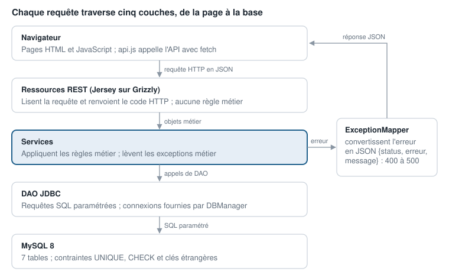

*Une requête descend de la page jusqu'à la base ; si un service refuse une règle, son exception est convertie en réponse JSON au format commun.*

### 2.1 Pile technique

| Besoin | Choix | Raison |
| --- | --- | --- |
| API REST | Jakarta REST 4 (JAX-RS) avec Jersey 4.0.2 | Standard Jakarta EE pour les webservices REST, annotations `@Path`, `@GET`, `@POST`… |
| Serveur HTTP | Grizzly embarqué | Fourni par Jersey, démarré par `Main` ; sert aussi les fichiers statiques |
| JSON | JSON-B (Yasson) | Conversion automatique des objets Java en JSON et inversement |
| Base de données | MySQL 8, pilote `mysql-connector-j` | Imposé par le sujet |
| Accès aux données | JDBC avec `PreparedStatement` | SQL écrit et lisible, aucun mapping à configurer |
| PDF | OpenPDF 2.0.3 | Bibliothèque libre, seule dépendance fonctionnelle ajoutée |
| Tests | JUnit 5.13, Mockito 5.20 | Tests unitaires de la couche service sans base de données |
| Packaging | Maven Shade | Un seul jar exécutable contenant toutes les bibliothèques |
| Front | HTML, CSS et JavaScript sans framework, `fetch` | Pages légères, aucune compilation |

### 2.2 Rôle de chaque couche

- **Pages web** (`src/main/resources/static`) : une page HTML et un script par rubrique. Un fichier commun `api.js` fait tous les appels à l'API et affiche les erreurs ; `layout.js` construit le menu selon le profil choisi ; `style.css` donne le style commun.
- **Ressources REST** (package `resource`) : elles lisent la requête, appellent le service et renvoient la réponse avec le bon code HTTP. Elles ne contiennent aucune règle métier. La ressource des séances, `SeanceController`, est restée dans le package `model` ; elle suit la même règle et délègue tout à `SeanceService`.
- **Services** (package `service`) : ils portent les règles de gestion et lèvent des exceptions métier quand une règle n'est pas respectée.
- **DAO** (package `dao`) : accès JDBC à la base, une classe (ou une interface et son implémentation) par table ; les connexions viennent de `DBManager`.
- **Modèle** (package `model`) : les objets métier (`Photographe`, `Client`, `Seance`, `Facture`…) et les énumérations de statut, sérialisés en JSON.
- **DTO** (packages `dto` et `resource`) : objets échangés avec le front quand ils diffèrent du modèle (`ClientRequete`, `PeriodeRequete`, `ResultatChangementStatut`…).
- **Exceptions** (package `exception`) : les exceptions métier et les `ExceptionMapper` qui les convertissent en réponses JSON (section 4.2).

### 2.3 Pourquoi Jersey et JDBC plutôt que Payara et JPA

Le plan initial prévoyait Payara Micro avec JPA et CDI. Le groupe a gardé Jersey, Grizzly et JDBC, déjà utilisés dans le socle commun :

- **Maîtrise** : chaque requête SQL est écrite à la main, ce qui rend visibles les règles appliquées en base (chevauchement des séances, annulation des séances à venir, statistiques, numérotation des factures). Il n'y a ni chargement paresseux ni mapping d'héritage à comprendre.
- **Légèreté** : `mvn compile exec:java` lance l'application en quelques secondes, et `java -jar studiophoto.jar` suffit en production.
- **Testabilité** : les services reçoivent leurs DAO et une horloge (`java.time.Clock`) par le constructeur. Les tests leur passent des DAO simulés et une heure fixe.
- **Contrepartie** : le code JDBC est plus long qu'avec JPA, et les transactions sur plusieurs tables sont gérées à la main (`setAutoCommit(false)`, `commit`, `rollback`), par exemple pour un photographe et ses spécialités.

### 2.4 Configuration

Les paramètres sont dans `src/main/resources/application.properties` (adresse du serveur, URL, utilisateur et mot de passe MySQL), inclus dans le jar. `DBManager` permet de les remplacer au lancement, sans reconstruire le jar ni versionner le mot de passe, par ordre de priorité : option `-Ddatabase.password=…`, puis variable d'environnement `DATABASE_PASSWORD`, puis le fichier. Même principe pour `database.url` et `database.login`.

## 3. Modèle de données

La base compte sept tables MySQL, créées par `sql/01_schema.sql` et remplies par `sql/02_donnees_test.sql`. Les règles qui doivent tenir même en cas d'erreur dans le code sont aussi écrites en contraintes SQL.

| Table | Contenu | Contraintes notables |
| --- | --- | --- |
| `specialite` | Reportage, Mariage et fêtes, Famille | Libellé unique |
| `photographe` | Nom, email, statut actif | Email unique |
| `photographe_specialite` | Liaison plusieurs-à-plusieurs | Supprimée en cascade avec le photographe |
| `client` | Particuliers et entreprises dans une seule table | `CHECK` : nom et prénom pour un particulier, raison sociale et SIREN/TVA pour une entreprise |
| `type_seance` | Portrait, Mariage, Reportage entreprise, Famille | Tarif horaire HT positif |
| `seance` | Date, heure, durée, lieu, statut, type, photographe, client | Durée positive ; clés étrangères en `ON DELETE RESTRICT` ; index sur photographe et date |
| `facture` | Numéro, montants, statut de paiement, copie du client et de la prestation | Numéro unique ; `seance_id` unique (relation 1-1) ; TTC ≥ HT |

**Héritage des clients en table unique.** Un client particulier et un client entreprise partagent l'adresse et l'email ; seuls deux champs changent. Une table unique avec une colonne `type` (l'équivalent de la stratégie JPA `SINGLE_TABLE`) évite une jointure à chaque lecture, alors qu'une table par sous-classe (`JOINED`) n'apporterait rien pour deux colonnes. La contrainte `CHECK` garantit que chaque ligne a les champs de son type. Côté Java, `Client` est abstraite, avec deux sous-classes `ClientParticulier` et `ClientEntreprise` ; le DAO lit la colonne `type` pour instancier la bonne.

**Facture figée.** À la génération, la facture copie les coordonnées du client et le détail de la prestation (date, heure, durée, type, photographe). Si le client change d'adresse ensuite, une facture déjà émise ne change pas.

**Suppressions protégées.** Les clés étrangères en `RESTRICT` empêchent de supprimer un photographe, un client ou un type encore utilisé par une séance, et une séance qui a une facture. Les services font le même contrôle avant, pour renvoyer un message clair (409).

**Données de test.** Le script crée 6 photographes dont 1 inactif, 7 clients (4 particuliers, 3 entreprises), 4 types de séance, 19 séances dans les quatre statuts et 8 factures. Les dates sont calculées à partir du jour d'exécution (`CURDATE()`), donc les séances passées et à venir restent cohérentes quel que soit le jour où l'on recharge la base.

## 4. API REST

L'API expose 28 routes sous `/api`, toutes en JSON sauf le PDF des factures. Les ressources sont des noms au pluriel, les méthodes HTTP suivent leur sens habituel, et toutes les erreurs ont le même format. Le contrat complet est dans `openapi.yaml` (section 4.3).

### 4.1 Routes

| Méthode | Route | Rôle | Succès | Erreurs |
| --- | --- | --- | --- | --- |
| GET | `/photographes[?actif=true\|false]` | Lister les photographes | 200 | – |
| GET | `/photographes/{id}` | Détail d'un photographe | 200 | 404 |
| POST | `/photographes` | Créer un photographe | 201 | 400, 409 |
| PUT | `/photographes/{id}` | Modifier nom, email, spécialités | 200 | 400, 404, 409 |
| PATCH | `/photographes/{id}/statut[?confirmer=true]` | Activer ou désactiver | 200 | 400, 404, 409 |
| DELETE | `/photographes/{id}` | Supprimer un photographe sans séance | 204 | 404, 409 |
| GET | `/specialites` | Liste fixe des spécialités | 200 | – |
| GET | `/clients` | Lister les clients | 200 | – |
| GET | `/clients/{id}` | Détail d'un client | 200 | 404 |
| POST | `/clients` | Créer un client | 201 | 400, 415 |
| PUT | `/clients/{id}` | Modifier un client (le type peut changer) | 200 | 400, 404 |
| DELETE | `/clients/{id}` | Supprimer un client sans séance | 204 | 404, 409 |
| GET | `/seances[?photographeId=&dateDebut=&dateFin=]` | Planning filtré, trié par date et heure | 200 | 400 |
| GET | `/seance[?…]` | Même liste, ancienne route au singulier conservée pour compatibilité | 200 | 400 |
| GET | `/seances/{id}` | Détail d'une séance | 200 | 404 |
| GET | `/seances/options` | Types, photographes actifs et clients pour les formulaires | 200 | – |
| POST | `/seances` | Créer une séance | 201 | 400, 409 |
| PUT | `/seances/{id}` | Modifier une séance | 200 | 400, 404, 409 |
| PATCH | `/seances/{id}/statut` | Changer le statut | 200 | 400, 404, 409 |
| DELETE | `/seances/{id}` | Supprimer une séance non facturée | 204 | 404, 409 |
| POST | `/seances/{id}/facture` | Générer la facture | 201 | 404, 409 |
| GET | `/factures` | Lister les factures | 200 | – |
| GET | `/factures/{id}` | Détail d'une facture | 200 | 404 |
| GET | `/factures/{id}/pdf` | Télécharger le PDF | 200 | 404 |
| PATCH | `/factures/{id}/statut` | Changer le statut de paiement | 200 | 400, 404, 409 |
| GET | `/statistiques/photographes_par_seances` | Top 5 par nombre de séances réalisées | 200 | – |
| GET | `/statistiques/photographes_par_duree` | Top 5 par durée cumulée | 200 | – |
| POST | `/statistiques/chiffre_affaires_pour_periode` | Chiffre d'affaires d'une période (dates dans le corps) | 200 | 400 |

Une création répond 201 avec l'en-tête `Location` (URL de l'élément créé), une suppression 204 sans corps. Un changement de statut passe par `PATCH` sur une sous-ressource `/statut`, car il a ses propres règles, distinctes d'une modification complète par `PUT`. Les identifiants de séance sont contraints à des chiffres (`{id: \d+}`) pour que `/seances/options` ne soit jamais pris pour un identifiant.

### 4.2 Gestion des erreurs

Toute réponse en erreur a le même corps JSON, et le front affiche le champ `message` tel quel :

```json
{ "status": 409, "erreur": "Conflict", "message": "Le photographe a déjà une séance sur ce créneau (26/11/2026, 17h00 – 19h00)." }
```

| Exception | Code | Converti par |
| --- | --- | --- |
| `DonneesInvalidesException` | 400 | `MetierExceptionMapper` |
| `RessourceIntrouvableException` | 404 | `MetierExceptionMapper` |
| `ConflitException` | 409 | `MetierExceptionMapper` |
| `ConfirmationRequiseException` | 409 + `nombreSeances` | `ConfirmationRequiseExceptionMapper` |
| `DaoException` | 500, sans détail technique | `DaoExceptionMapper` |
| Erreurs Jersey (JSON illisible, route ou méthode inconnue, mauvais format) | 400, 404, 405, 415 | `WebApplicationExceptionMapper`, `ProcessingExceptionMapper` |

Les services lèvent les exceptions métier, sous-classes de `MetierException` qui portent chacune leur code HTTP ; les ressources ne les attrapent pas. Quand deux convertisseurs conviennent, JAX-RS choisit celui dont le type d'exception est le plus proche : `ConfirmationRequiseExceptionMapper` passe donc avant `MetierExceptionMapper`. Une erreur de base de données est écrite dans les journaux du serveur, et le client ne reçoit qu'un message générique. Un JSON mal formé donne un 400 en JSON plutôt que la page d'erreur HTML de Grizzly.

### 4.3 Documentation Swagger

Le contrat est écrit dans `src/main/resources/static/openapi.yaml` (OpenAPI 3.0.3) et affiché par Swagger UI sur `http://localhost:8080/swagger/`. Les fichiers de Swagger UI sont servis comme fichiers statiques, sans dépendance Java, et fonctionnent sans connexion internet, y compris depuis le jar. Toutes les rubriques y sont décrites : routes, paramètres, corps de requête avec exemples, codes de retour et format d'erreur. Le bouton « Try it out » interroge directement l'API en cours d'exécution.

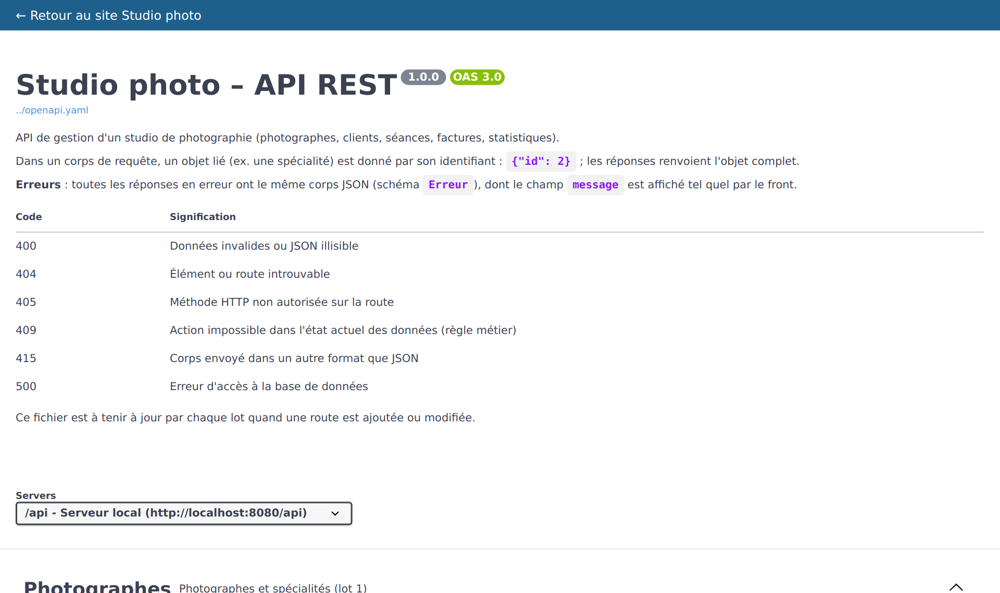

## 5. Règles métier et choix d'implémentation

Chaque règle du sujet est appliquée côté serveur, dans un service ou en SQL, pour ne pas dépendre du front : un autre client de l'API ne peut pas la contourner. Les sous-sections suivent les rubriques du site.

### 5.1 Photographes (lot 1)

- **Validation** : nom obligatoire (100 caractères au plus) ; email obligatoire, au format `texte@domaine.ext`, unique sans tenir compte de la casse. L'email est enregistré en minuscules pour éviter `Alice@…` et `alice@…`. Le doublon est détecté par le service (message clair) et par la contrainte `UNIQUE` (deux requêtes simultanées), traduit dans les deux cas en 409.
- **Spécialités** : liste fixe lue en base ; un photographe en a zéro, une ou plusieurs. Le front envoie leurs identifiants (`"specialites": [{"id": 2}]`), le service vérifie qu'ils existent et retire les doublons. Le photographe et ses liaisons sont écrits dans une même transaction.
- **Statut** : un photographe est créé actif. `PUT` ne change pas son statut : il a sa propre route, avec ses propres règles.
- **Désactivation en deux temps** : si le photographe a des séances à venir (planifiées ou confirmées, début dans le futur), une première requête répond 409 avec leur nombre et ne modifie rien. Le front affiche ce nombre dans une boîte de confirmation, puis renvoie la requête avec `?confirmer=true` : le photographe est désactivé et ces séances passent en `ANNULEE`. Les séances passées ne bougent pas.
- **Choix** : c'est le serveur qui compte les séances et exige la confirmation, plutôt que le front. Le photographe est désactivé avant l'annulation, pour qu'aucune séance ne lui soit affectée entre les deux.
- **Suppression** : refusée (409) dès que le photographe a une séance, même passée ou annulée ; l'interface propose alors de le désactiver. Supprimer ses séances effacerait l'historique et rendrait des factures orphelines. Un photographe créé par erreur, sans séance, peut être supprimé.

### 5.2 Clients (lot 2)

- **Deux types dans un seul JSON** : la requête porte un champ `type` (`PARTICULIER` ou `ENTREPRISE`). JSON-B ne sait pas instancier la classe abstraite `Client` : la ressource reçoit donc tous les champs possibles dans un objet `ClientRequete`, qui crée à la main la bonne sous-classe. Un type absent ou inconnu donne 400 avec les valeurs possibles.
- **Validation selon le type** : adresse (255 caractères) et email valides pour tous ; nom et prénom pour un particulier ; raison sociale et numéro pour une entreprise. Le numéro est un SIREN de 9 chiffres ou un numéro de TVA français (`FR` + 2 caractères + 9 chiffres). Toutes les erreurs sont renvoyées ensemble dans un seul message 400, pour que l'utilisateur corrige tout en une fois.
- **Nettoyage** : les espaces superflus sont retirés et un champ vide est traité comme absent ; le numéro est normalisé (`fr 12 902 345 678` devient `FR12902345678`).
- **Choix sur le SIREN** : seul le format est contrôlé, pas la clé de contrôle (algorithme de Luhn), car les numéros fictifs des données de test ne la respectent pas. L'ajouter ne demanderait que quelques lignes dans le service.
- **Suppression** : refusée (409) si le client a des séances, quel que soit leur statut, avec leur nombre dans le message : ses séances et factures doivent garder leur client.

### 5.3 Séances (lot 3)

Toutes les règles sont regroupées dans `SeanceService` ; la ressource REST ne fait que lui transmettre les données reçues.

- **Création** : date, heure, durée, lieu, type, photographe et client obligatoires ; durée et identifiants positifs ; type et client doivent exister (400). Statut initial `PLANIFIEE`.
- **Pas de séance dans le passé** : le début doit être après l'instant présent, sinon 400. En modification, le contrôle n'est refait que si la date ou l'heure change, ce qui permet de corriger le lieu d'une séance déjà commencée.
- **Photographe actif** : vérifié par le service (409 avec un message clair), et de nouveau dans la requête d'insertion elle-même (`INSERT … SELECT … WHERE actif = TRUE`). Le formulaire ne propose d'ailleurs que les photographes actifs.
- **Pas de chevauchement** : une requête SQL cherche une séance du même photographe qui commence avant la fin de la nouvelle et finit après son début. Les créneaux sont des intervalles semi-ouverts : deux séances bout à bout (fin de l'une à 12h00, début de l'autre à 12h00) sont acceptées. Les séances annulées sont ignorées, et en modification la séance elle-même est exclue du calcul (409 sinon).
- **Statuts** : les transitions sont décrites à un seul endroit, `StatutSeance.peutPasserA()`. Une séance ne passe à `TERMINEE` qu'une fois son heure de fin passée. Une transition interdite répond 409 avec un message adapté (« La séance ne pourra être terminée qu'après sa fin, le … »).
- **Modification** : refusée (409) pour une séance `TERMINEE` ou `ANNULEE`. Le statut peut aussi changer par le formulaire complet, avec les mêmes contrôles de transition.
- **Suppression** : refusée (409) si une facture existe, pour que la facture reste rattachée à sa prestation ; il faut alors annuler la séance ou la facture.
- **Testabilité** : le service reçoit une `Clock`, et `peutPasserA()` accepte l'instant présent en paramètre : les tests figent « maintenant » pour vérifier les cas limites.

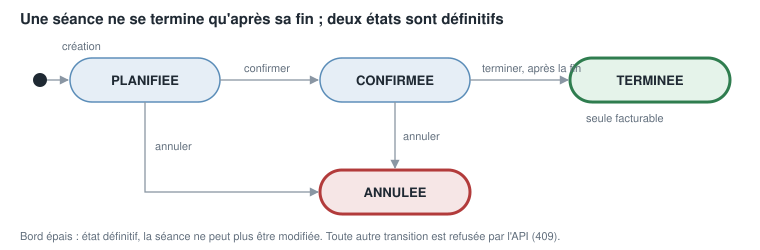

*Une séance part de `PLANIFIEE` ; seule une séance `TERMINEE` peut être facturée, et `TERMINEE` comme `ANNULEE` ne changent plus.*

**Cas d'utilisation « changer le statut d'une séance ».** C'est l'UC présenté à l'oral. Sur la fiche d'une séance, les boutons ne proposent que les transitions autorisées (« Terminer » est grisé tant que la séance n'est pas finie). Le clic envoie `PATCH /api/seances/{id}/statut`. `SeanceService.changerStatut()` relit la séance, vérifie la transition avec `peutPasserA()` à l'heure courante, puis enregistre le nouveau statut. En cas de refus, une `ConflitException` devient une réponse 409 dont le message s'affiche en haut de la page. Quand la séance passe à `TERMINEE`, la page propose directement de générer la facture. Le serveur reste seul juge : le grisage des boutons n'est qu'un confort d'affichage.

### 5.4 Facturation (lot 4)

- **Génération** : refusée (409) si la séance n'est pas `TERMINEE` ou a déjà une facture. Statut initial `EN_ATTENTE`, date d'émission du jour.
- **Montants** : HT = tarif horaire du type × durée en heures ; TVA à 20 % ; TTC = HT × 1,20. Tous les calculs sont en `BigDecimal`, arrondis au centime (arrondi au plus proche), pour éviter les erreurs des nombres à virgule flottante.
- **Numérotation** : `FAC-AAAA-NNNN`, le numéro qui suit le dernier de l'année, 0001 pour la première facture de l'année. Si deux générations simultanées prennent le même numéro, la contrainte `UNIQUE` refuse la seconde, et le service réessaie avec le numéro suivant (3 essais au plus).
- **Facture figée** : coordonnées du client (SIREN/TVA pour une entreprise) et détail de la prestation sont copiés à la génération (section 3).
- **Paiement** : `EN_ATTENTE` peut passer à `PAYEE` ou `ANNULEE`, rien d'autre (409). Si la facture a changé entre la lecture et l'écriture, la mise à jour est refusée et l'utilisateur doit recharger.
- **PDF** : `GET /factures/{id}/pdf` produit le document avec OpenPDF à chaque demande, à partir des données figées. Aucun fichier n'est stocké, et le document est toujours identique.

### 5.5 Statistiques (lot 5)

- **Top 5 par nombre de séances réalisées** : une requête `GROUP BY` sur les séances `TERMINEE`, triée par nombre décroissant puis par nom, limitée à 5 lignes. Le calcul, le tri et la limite sont faits par MySQL : seules les lignes utiles sont lues.
- **Top 5 par durée cumulée** : même requête avec `SUM(duree_minutes)`.
- **Chiffre d'affaires** : somme des montants TTC des factures `PAYEE` dont la date d'émission est entre les deux dates, incluses. Les factures en attente ou annulées sont exclues. Une période sans facture donne 0.
- **Contrôle des dates** : date absente, mal formée ou début après fin donnent 400 avec un message explicite.
- **Choix** : le chiffre d'affaires est calculé en TTC, c'est-à-dire la somme réellement encaissée par le studio.

## 6. Interface web

Le front est fait de pages HTML statiques, une par rubrique, chacune avec son propre script ; seuls `api.js`, `layout.js` et `style.css` sont communs. Ce découpage a permis à chaque lot de travailler sur ses fichiers sans conflit Git.

| Page | Ce qu'on y fait |
| --- | --- |
| `index.html` | Choix du profil, puis une carte par rubrique autorisée |
| `photographes.html` | Liste filtrable (tous, actifs, inactifs), formulaire avec cases à cocher pour les spécialités, boutons Modifier, Activer ou Désactiver, Supprimer |
| `clients.html` | Liste avec recherche (sans tenir compte des accents) et filtre par type, formulaire unique qui bascule entre particulier et entreprise |
| `seances.html` | Liste des séances avec accès à la fiche, à la modification et à la facture |
| `seance.html` | Fiche d'une séance : détail et boutons de changement de statut, de modification et de suppression |
| `create_seance.html`, `update_seance.html` | Formulaires de création et de modification (listes déroulantes des photographes actifs, clients et types) |
| `planning.html` | Vue jour ou semaine, navigation par période, filtre par photographe, couleur selon le statut ; l'état est gardé dans l'URL |
| `factures.html` | Liste avec recherche et filtre par statut, détail avec montants, téléchargement du PDF, changement du statut de paiement |
| `statistiques.html` | Les deux classements et le calcul du chiffre d'affaires sur une période choisie |
| `swagger/` | Documentation interactive de l'API |

**Profils.** Au premier affichage, l'accueil demande « Qui êtes-vous ? ». D'après le diagramme de cas d'utilisation, le gestionnaire voit toutes les rubriques, la secrétaire les clients, séances, planning et factures, et le photographe uniquement son propre planning. Une page non autorisée renvoie vers l'accueil du profil. Ce n'est volontairement pas une authentification (pas de mot de passe, profil gardé dans le navigateur) : c'est une aide à la navigation, l'authentification restant une perspective (section 10).

**Appels à l'API.** `api.js` fournit `api.get`, `api.post`, `api.put`, `api.patch` et `api.delete`. En cas d'erreur (code 4xx ou 5xx, serveur injoignable), il lit le champ `message` du format commun, l'affiche en haut de la page et rejette la promesse : chaque page n'a qu'à arrêter son traitement.

**Sécurité de l'affichage.** Toute donnée insérée dans la page passe par `echapperHtml()`, pour qu'un nom saisi ne soit pas interprété comme du HTML (protection contre l'injection de script).

**Confirmations.** Les actions lourdes (désactivation, suppression, annulation) passent par une boîte de confirmation. Pour la désactivation d'un photographe qui a des séances à venir, une seconde boîte affiche leur nombre, reçu dans la réponse 409.

Les captures ci-dessous montrent les principales pages avec les données de test.

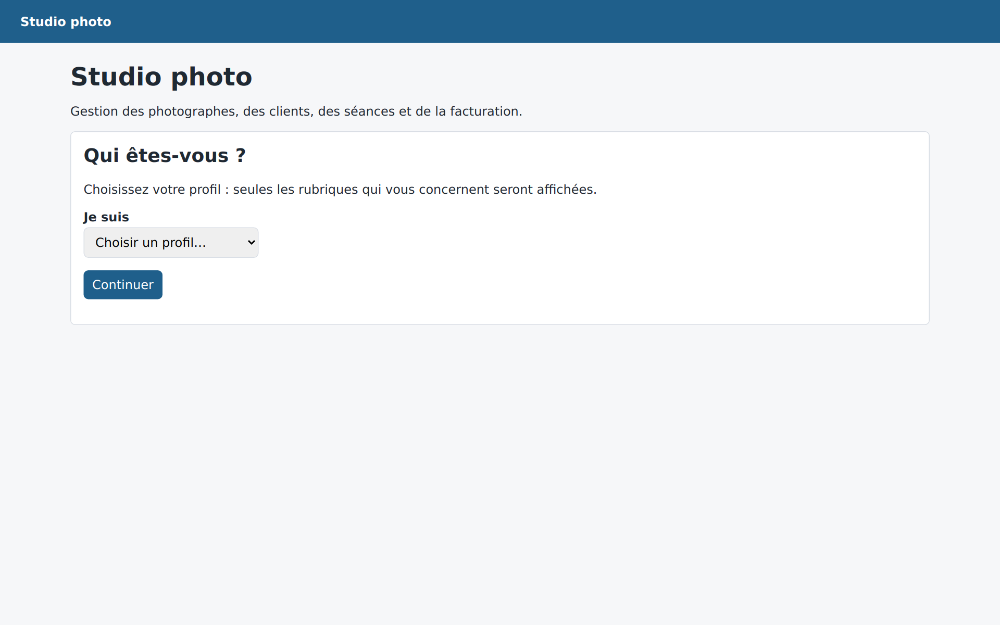
*Accueil : choix du profil.*

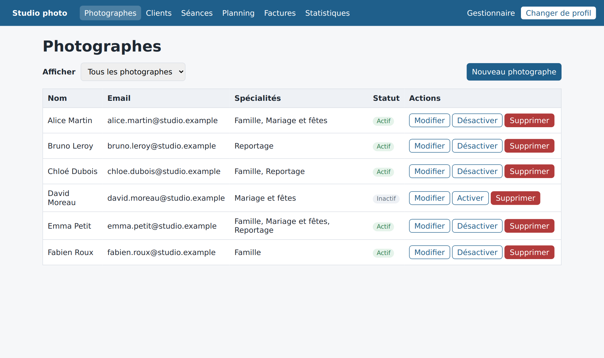
*Photographes : liste, statut et actions.*

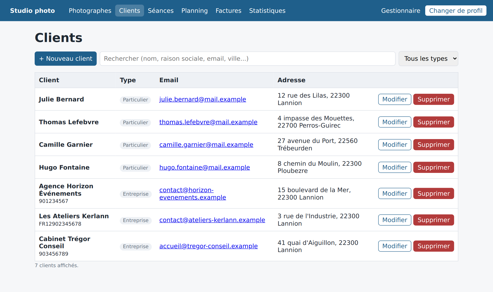
*Clients : particuliers et entreprises dans une même liste.*

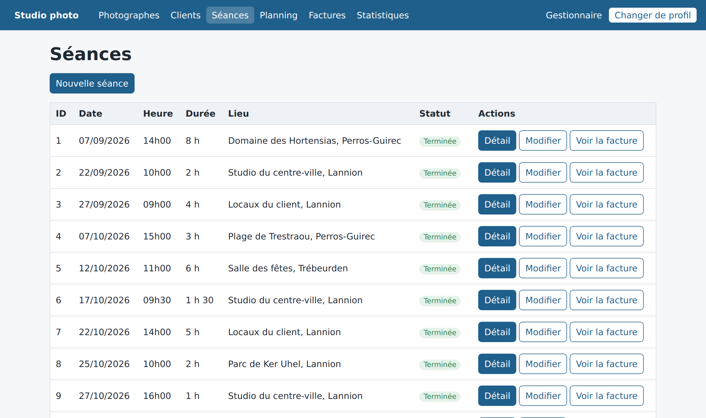
*Séances : liste avec accès à la fiche, à la modification et à la facture.*

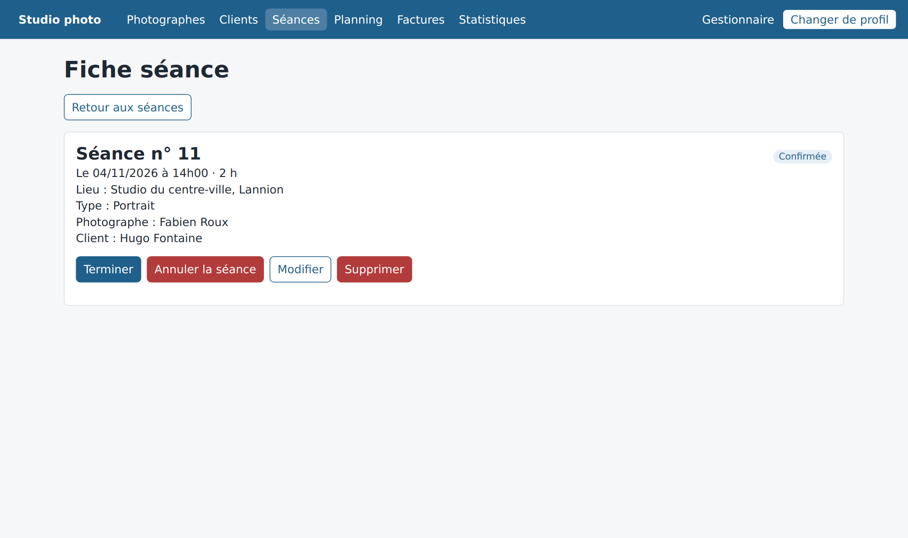
*Fiche d'une séance confirmée dont la date est passée : elle peut être terminée.*

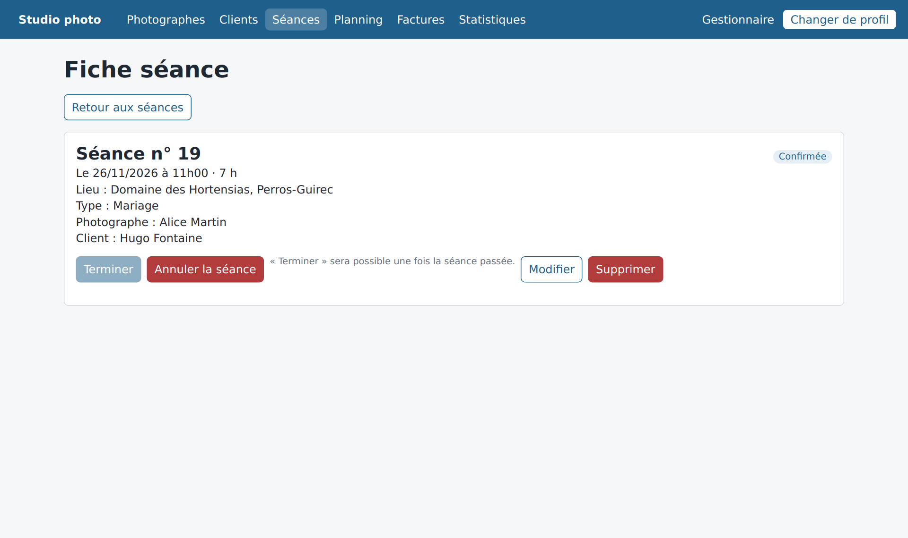
*Fiche d'une séance confirmée à venir : « Terminer » est grisé.*

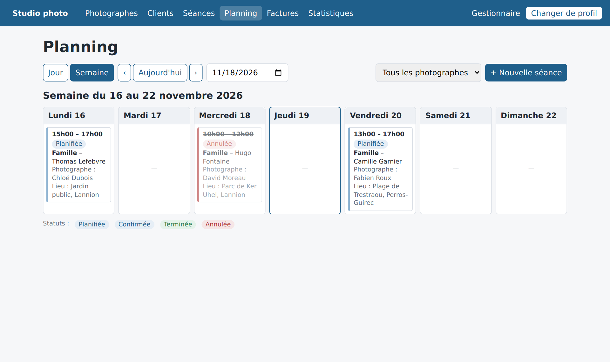
*Planning : vue semaine, couleur selon le statut.*

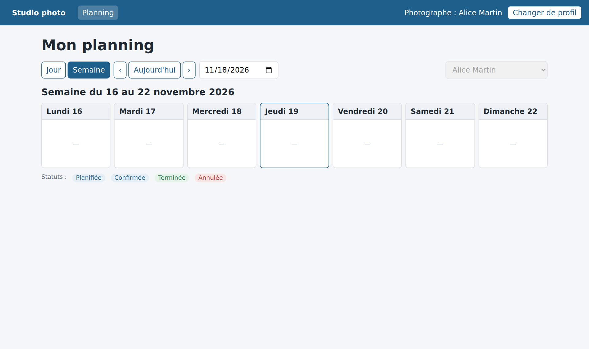
*Profil photographe : seul son planning est accessible.*

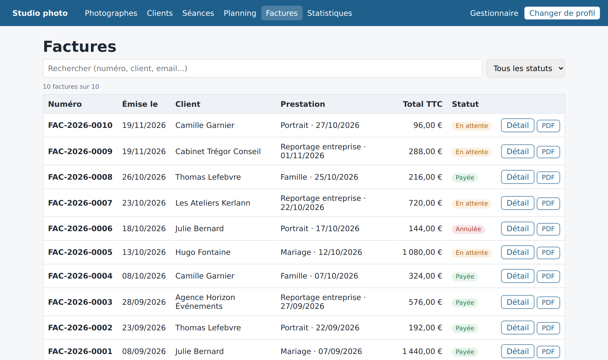
*Factures : liste, statut de paiement et téléchargement du PDF.*

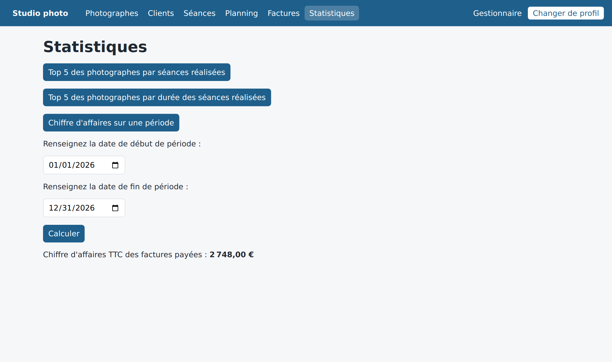
*Statistiques : chiffre d'affaires des factures payées sur une période.*

## 7. Tests et qualité

La couche service et les règles métier principales sont couvertes par 118 méthodes de test JUnit 5, soit 151 tests à l'exécution, car certaines méthodes sont paramétrées (un cas par valeur testée). `mvn test` les lance toutes, sans base de données.

| Classe de test | Méthodes | Ce qui est vérifié |
| --- | --- | --- |
| `ClientServiceTest` (lot 2) | 28 | Champs obligatoires selon le type, SIREN et TVA invalides ou normalisés, email mal formé, erreurs regroupées, client inconnu (404), suppression refusée |
| `PhotographeServiceTest` (lot 1) | 24 | Email invalide ou en double, spécialité inconnue, désactivation avec et sans séances à venir, séances passées non annulées, suppression refusée |
| `FactureServiceTest` (lot 4) | 24 | Séance non terminée ou déjà facturée, première facture de l'année, numéro suivant, compteur annuel, nouvel essai après un numéro pris, coordonnées figées, statut de paiement |
| `SeanceServiceTest` (lot 3) | 20 | Séance dans le passé, photographe inactif, chevauchement partiel ou inclus, séances bout à bout, séances annulées ignorées, modification sans conflit avec elle-même, séance définitive, transitions autorisées et interdites, terminer avant la fin, suppression |
| `ExceptionMapperTest` | 8 | Conversion de chaque exception au format commun, 500 sans détail technique, message explicite conservé |
| `StatistiquesServiceTest` (lot 5) | 7 | Classements, période valide, période d'un seul jour, période sans facture, date manquante ou mal formée, période inversée |
| `TarificationTest` (lot 4) | 6 | Calcul HT et TTC, TVA à 20 %, deux décimales, tarif ou durée invalide |
| `StatutPaiementTest` (lot 4) | 1 | Chaque transition de paiement, autorisée ou non (test paramétré) |

**Sans base de données.** Chaque service reçoit ses DAO par son constructeur. Les tests lui passent des faux DAO en mémoire, écrits à la main (lot 1), ou des simulations Mockito (lots 2, 3, 4 et 5). Un test vérifie ainsi une règle sans dépendre des données présentes en base.

**À heure fixe.** Les services qui dépendent de la date reçoivent une `java.time.Clock`. Les tests la figent, ce qui permet de tester des cas limites : une séance qui commence à la minute près, une séance qu'on veut terminer une minute avant sa fin, la première facture d'une nouvelle année.

**Qualité du code.** Toute valeur reçue dans une requête atteint la base par un paramètre de `PreparedStatement`, jamais par concaténation dans le texte SQL (protection contre l'injection SQL). Les erreurs techniques sont écrites dans les journaux du serveur et jamais renvoyées au client.

**Vérifications manuelles.** En plus des tests unitaires, chaque règle a été vérifiée sur le serveur lancé (requêtes `curl` et parcours complets dans le navigateur), et le jar a été lancé seul avec `java -jar`.

Résultat de `mvn test` au moment du rendu : **151 tests, 0 échec, 0 erreur**.

## 8. Organisation du travail

Le travail a suivi trois phases : un socle commun fait ensemble, cinq lots verticaux développés en parallèle, puis l'intégration. Chaque lot couvre sa rubrique de bout en bout : service, règles, API, tests et pages.

| Lot | Périmètre | Responsable |
| --- | --- | --- |
| Lot 1 | Photographes et spécialités | [nom] |
| Lot 2 | Clients, planning, documentation Swagger | [nom] |
| Lot 3 | Séances et statuts | [nom] |
| Lot 4 | Facturation et PDF | [nom] |
| Lot 5 | Statistiques et socle technique | [nom] |

**Phase 0, le socle commun.** Elle a figé ce que tous les lots partagent, pour que personne n'attende personne : schéma SQL, script de données de test, classes du modèle, format d'erreur, contrat d'API et squelette du front (menu, style, `api.js`). Un lot qui dépend d'un autre teste avec les données de test au lieu d'attendre son code.

**Dépendances entre lots**, peu nombreuses et connues dès le départ :

| Lot | Utilise | Pour |
| --- | --- | --- |
| Lot 1 | `SeanceDAO` (lot 3) | Annuler les séances à venir d'un photographe désactivé |
| Lot 2 | Route de lecture des séances (lot 3) | Afficher le planning |
| Lot 4 | `Seance`, `Client`, `TypeSeance` | Vérifier le statut, figer les coordonnées, calculer le montant |
| Lot 4 | Pages des séances (lot 3) | Ajouter le bouton « Générer la facture » |
| Lot 5 | `Seance`, `Facture` | Calculer les statistiques |

**Git.** Le dépôt est hébergé sur le GitLab de l'ENSSAT (`gitlab.enssat.fr/maubry/jeephoto`). La branche `main` est protégée : chaque lot travaille sur sa propre branche, fusionnée dans `main` par merge request ; avant de fusionner, chacun intègre la dernière version de `main` dans sa branche et règle les conflits de son côté. Chaque lot a ses propres pages et scripts, ce qui limite les conflits aux fichiers communs (`pom.xml`, `Main.java`, exceptions, `openapi.yaml`).

**Règles communes.** Une route, un JSON ou une classe partagée ne change qu'après accord du groupe. Chaque classe du modèle appartient au lot de sa rubrique : les autres la lisent mais ne la modifient pas sans prévenir. Les choix à justifier sont notés au fil de l'eau dans `docs/`, pour ce rapport.

## 9. Installation et lancement

La procédure complète est dans `README.md`. En résumé, depuis le dossier du projet :

**Prérequis** : Java 25 et l'accès au serveur MySQL (port 3306). Maven et le client `mysql` ne sont nécessaires que pour compiler et pour (re)créer la base.

1. **Créer les tables et charger les données de test** (le script recrée les tables, les données existantes sont perdues) :

   ```bash
   cat sql/01_schema.sql sql/02_donnees_test.sql | mysql -h <hôte> -P 3306 -u <utilisateur> -p <schéma>
   ```

2. **Renseigner la connexion** dans `src/main/resources/application.properties` (`database.url`, `database.login`, `database.password`), ou la donner au lancement (section 2.4). L'adresse du serveur se règle avec `server.base.uri` (par défaut `http://localhost:8080`).

3. **Construire et lancer le jar** :

   ```bash
   mvn clean package                  # produit target/studiophoto.jar, bibliothèques incluses
   java -jar target/studiophoto.jar   # ou : mvn compile exec:java pendant le développement
   ```

4. Attendre le message « Application démarrée », puis ouvrir :

| Quoi | Adresse |
| --- | --- |
| Site | `http://localhost:8080/` |
| API REST | `http://localhost:8080/api/…` |
| Documentation Swagger | `http://localhost:8080/swagger/` |

Pour vérifier la connexion à la base sans démarrer le serveur : `mvn compile exec:java -Dexec.mainClass=fr.enssat.studiophoto.DBManager`. Les tests se lancent avec `mvn test`.

## 10. Bilan et perspectives

Toutes les fonctionnalités demandées par le sujet sont implémentées, avec leurs règles métier appliquées côté serveur et testées.

| Exigence du sujet | État | Remarque |
| --- | --- | --- |
| Photographes : lister, créer, éditer, supprimer ; plusieurs spécialités | Fait | Suppression refusée s'il a des séances |
| Activation, désactivation confirmée, annulation des séances à venir | Fait | Confirmation demandée par l'API (409) |
| Photographe inactif non assignable à une séance | Fait | Contrôlé par le service et en SQL |
| Clients particuliers et entreprises : lister, créer, éditer, supprimer | Fait | Validation selon le type, SIREN ou TVA |
| Séances : planning, création, modification, suppression | Fait | Planning jour / semaine, filtre par photographe |
| Changement de statut selon les transitions autorisées | Fait | Table unique dans `StatutSeance` ; 409 sinon |
| Terminer une séance seulement après sa date | Fait | Contrôlé à l'heure de fin |
| Aucune séance dans le passé | Fait | À la création et quand le créneau change |
| Aucun chevauchement pour un photographe | Fait | Séances annulées ignorées, bout à bout autorisé |
| Facture : génération, numéro unique, montants, statut de paiement, PDF | Fait | Coordonnées figées à l'émission |
| Statistiques : deux top 5 et chiffre d'affaires sur une période | Fait | Calculs faits en SQL |
| API REST : méthodes, codes, ressources, erreurs | Fait | Format d'erreur commun ; écarts listés ci-dessous |
| Tests unitaires de la couche service, règles métier principales | Fait | 151 tests, 0 échec |
| Livrables : jar, scripts SQL, Swagger, procédure d'installation, rapport | Fait | `studiophoto.jar`, dossier `sql/`, `/swagger/`, `README.md`, ce document |

**Limites connues.** Quelques points s'écartent de nos propres conventions et seraient les premiers à reprendre :

- le chiffre d'affaires est une lecture servie par `POST` (dates dans le corps) ; un `GET` avec les dates en paramètres respecterait mieux REST ;
- les classements renvoient des paires `[nom, valeur]` plutôt que des objets nommés, et les routes des statistiques utilisent des tirets bas là où les autres sont d'un seul mot ;
- la ressource des séances est restée dans le package `model` au lieu de `resource`, et l'ancienne route `/seance` est conservée pour compatibilité ;
- le profil choisi à l'accueil n'est pas une authentification.

**Ce que le projet nous a appris.** Figer le socle commun dès le début (schéma, données de test, format d'erreur, contrat d'API) a permis à cinq personnes de coder en parallèle avec peu de conflits. Les fichiers partagés (`pom.xml`, `Main.java`, exceptions, `openapi.yaml`) ont concentré les conflits de fusion : deux lots ont par exemple écrit chacun leur couche d'exceptions avant de l'unifier. Les modifier par merge request annoncée au groupe est indispensable.

**Perspectives.** Au-delà du sujet : une vraie authentification avec des droits vérifiés par le serveur, l'intégration continue (compilation et tests à chaque merge request), et l'envoi de la facture PDF au client par email.
